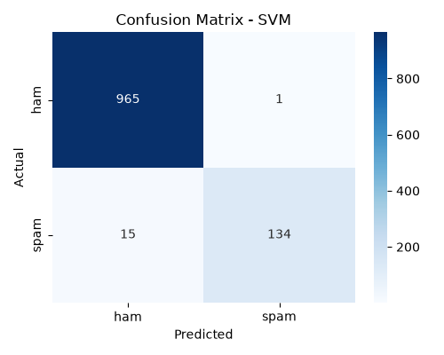
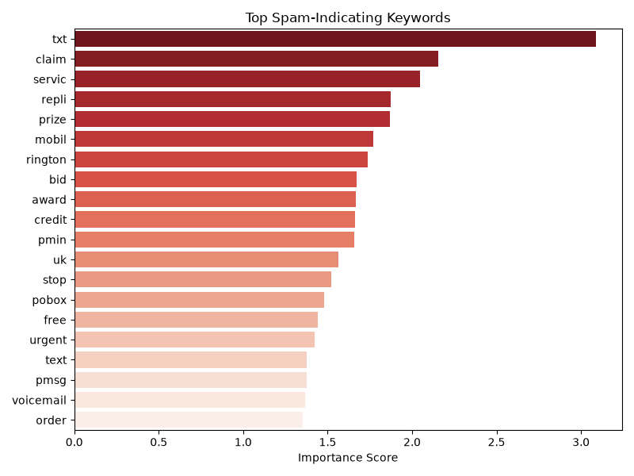

# Spam Message Classifier

A machine-learning project that classifies short messages as **spam** or **ham** (not spam). It cleans the text with NLP, converts it to TF-IDF features, trains and compares three models (Naive Bayes, Logistic Regression, SVM), and saves the best one for predictions.

> **Note:** the model is trained on the [SMS Spam Collection](https://archive.ics.uci.edu/dataset/228/sms+spam+collection) (5,572 labelled text messages), so it is best at short SMS-style messages. To use it for real emails, retrain it on an email dataset (see [Using your own data](#using-your-own-data)).

## Features
- Text preprocessing: lower-casing, removal of URLs / emails / numbers / punctuation, stop-word removal, Porter stemming
- TF-IDF vectorisation (top 5,000 features)
- Compares **Naive Bayes, Logistic Regression and a linear SVM** on a stratified 80/20 split
- Prints accuracy, precision, recall and F1 for each model and automatically saves the one with the best F1
- Saves a confusion matrix per model and a chart of the top spam-indicating keywords
- Interactive command-line predictor with a confidence score, and an importable `classify()` function

## Tech stack
Python 3.9+ · scikit-learn · pandas · NumPy · NLTK · matplotlib · seaborn · joblib

## Results
Best model: **linear SVM**, evaluated on a held-out test set of 1,115 messages (13% of the data is spam).

| Metric | Score |
|---|---|
| Accuracy | 98.6% |
| Precision (spam) | 99.3% |
| Recall (spam) | 89.9% |
| F1 (spam) | 0.944 |

Confusion matrix: 965 ham correct, 134 spam caught, 1 ham wrongly flagged as spam, 15 spam missed. The model is cautious: it rarely blocks a legitimate message, but lets some spam through.




## Setup
```bash
git clone https://github.com/<your-username>/spam-classifier.git
cd spam-classifier
python -m venv .venv
source .venv/bin/activate        # Windows: .venv\Scripts\activate
pip install -r requirements.txt
```
The first run downloads NLTK's stop-word list, so an internet connection is needed once.

## Usage
```bash
# 1. (optional) re-download the dataset; a copy is already in data/spam.csv
python download_data.py

# 2. train, compare the models and save the best one to model/
python train.py

# 3. classify messages interactively (type 'quit' to exit)
python predict.py
```
Use it from your own code:
```python
from predict import classify

print(classify("Congratulations! You've won a free prize, click now!"))
# {'label': 'spam', 'confidence': 0.99}
```
Run `python train.py` first: the trained model files are not stored in the repo, because they are tied to the scikit-learn version that created them.

## Using your own data
Replace `data/spam.csv` with any CSV that has a `label` column (`spam` / `ham`) and a `message` column, then run `python train.py` again.

## Project structure
```
data/spam.csv        cleaned dataset (label, message)
model/               trained model + vectorizer (created by train.py)
outputs/             confusion matrices and keyword chart
download_data.py     fetches and cleans the dataset
preprocess.py        text cleaning, shared by training and prediction
train.py             trains, evaluates and saves the best model
predict.py           command-line classifier
```

## Limitations
- Trained only on English SMS messages, so accuracy on emails or other languages will be lower.
- The data is imbalanced (about 13% spam) and contains some duplicate messages, so accuracy alone flatters the model; look at precision, recall and F1.
- Numbers are removed during cleaning, which discards some useful signals (phone numbers, prices).
- Intended for learning; not a production spam filter.

## License
MIT
